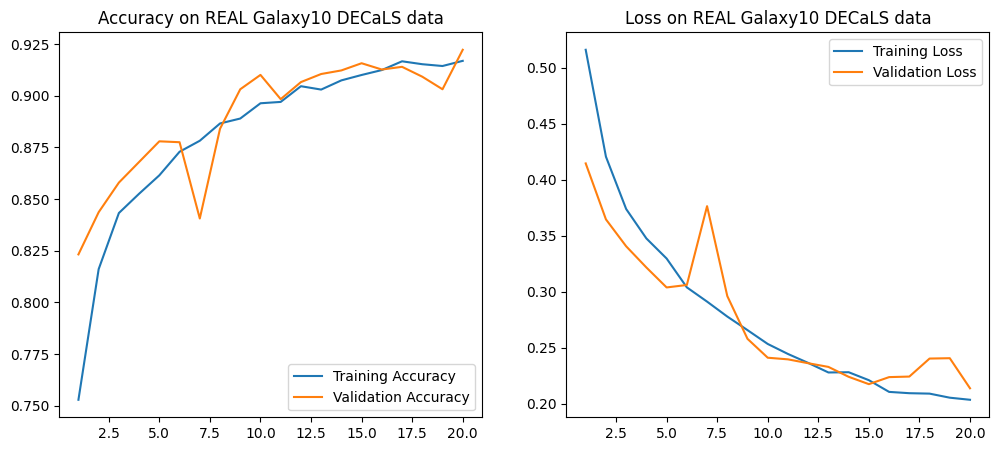
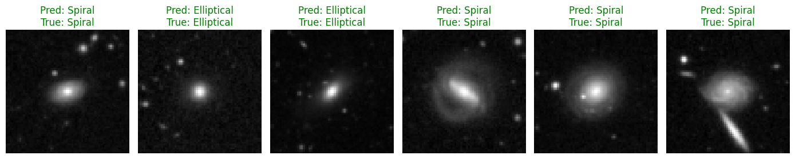

# Galaxy Morphology Classification using Deep Learning (PyTorch)

    

## 🌌 Project Overview

This project implements a **Convolutional Neural Network (CNN)** to automate the classification of galaxy morphologies. In modern astrophysics, understanding whether a galaxy is **Spiral** or **Elliptical** provides critical insights into its formation history and the evolution of the universe.

With next-generation surveys like **LSST (Rubin Observatory)** and **Euclid** expected to produce petabytes of data, manual classification by humans is no longer feasible. This project demonstrates an **automated, scalable Deep Learning pipeline** capable of processing such massive datasets.

The project follows a **simulate-then-validate** workflow:

1. **Synthetic stage:** build and debug the full pipeline on generated galaxy images where the ground truth is known exactly.
2. **Real-data stage:** train the same CNN architecture on **real survey images** from [Galaxy10 DECaLS](https://github.com/henrysky/Galaxy10), reaching **~91–92% validation accuracy**.

---

## 📊 Results on Real Data (Galaxy10 DECaLS)

| Metric | Value |
|---|---|
| Dataset | Galaxy10 DECaLS (DESI Legacy Imaging Surveys, Galaxy Zoo labels) |
| Images used | 11,506 (5,006 Elliptical / 6,500 Spiral) |
| Train / Validation split | 9,204 / 2,302 (80 / 20) |
| Input | 64×64 grayscale (downsampled from 256×256 RGB) |
| Epochs | 20 |
| **Final validation accuracy** | **92.2%** |
| Validation accuracy, last 8 epochs | 90.3% – 92.2% |
| Final validation loss | 0.214 |
| Majority-class baseline | ~56.5% |

### Class mapping

Galaxy10 DECaLS has 10 morphology classes. They are reduced to a clean binary problem:

| Binary label | Galaxy10 classes |
|---|---|
| **Elliptical** | Round Smooth (2), In-between Round Smooth (3), Cigar-shaped Smooth (4) |
| **Spiral** | Barred Spiral (5), Unbarred Tight Spiral (6), Unbarred Loose Spiral (7) |
| *Dropped* | Disturbed (0), Merging (1), Edge-on without bulge (8), Edge-on with bulge (9) |

The dropped classes do not map cleanly onto either label and would only add label noise.

### Training Performance



*Figure 1: Accuracy and loss over 20 epochs on real Galaxy10 DECaLS images. Training and validation curves track each other closely, with no significant overfitting.*

### Model Predictions



*Figure 2: Predictions on real validation-set galaxies (green = correct).*

### Synthetic vs. Real

| | Synthetic data | Real data (Galaxy10 DECaLS) |
|---|---|---|
| Images | 5,000 generated | 11,506 observed |
| Validation accuracy | Near-perfect | 92.2% |

The gap is expected. Real galaxies vary in brightness, size and orientation, sit among foreground stars and neighbouring sources, and include genuinely ambiguous objects near the smooth/spiral boundary. The synthetic stage confirms that the pipeline works; the real-data stage measures how well it actually performs.

---

## 🚀 How It Works

### The Challenge: "The Data Deluge"

*   **Old Physics:** Astronomers manually look at images (e.g., Galaxy Zoo).
*   **New Physics:** Telescopes capture billions of galaxies.
*   **Solution:** We train a Neural Network to "see" like an astronomer.

### The Pipeline

1.  **Synthetic Data Generation (`src/data_generator.py`):**
    *   Generates synthetic galaxy images to validate the pipeline end to end.
    *   **Elliptical:** Modeled as Gaussian blobs with random ellipticity.
    *   **Spiral:** Modeled using parametric equations for spiral arms with added noise.

2.  **Real Data Preparation (`notebooks/galaxy_classification_real_data.ipynb`):**
    *   Downloads Galaxy10 DECaLS (17,736 images, ~2.5 GB) from [Zenodo](https://zenodo.org/records/10845026).
    *   Filters to the six Elliptical/Spiral classes and maps them to binary labels.
    *   Converts to grayscale and resizes to 64×64 to match the model input.
    *   Augments training images with random horizontal/vertical flips and rotations (galaxy orientation on the sky is arbitrary).

3.  **Model Architecture (`src/model.py`):**
    *   **Input:** 1-channel Grayscale Image (64x64).
    *   **Layers:** 3 Convolutional Layers (Feature Extraction) + 2 Fully Connected Layers (Classification).
    *   **Activation:** ReLU for non-linearity.
    *   **Optimization:** Adam Optimizer (lr = 0.001) with Cross-Entropy Loss.
    *   The same architecture is used unchanged for both synthetic and real data.

4.  **Training & Validation (`src/main.py` / notebook):**
    *   Splits data into Training (80%) and Validation (20%) sets.
    *   Optimizes weights using backpropagation.
    *   Evaluates performance on unseen data.

---

## 🛠️ Installation & Usage

### Prerequisites

*   Python 3.8+
*   pip

### 1. Clone the Repository

```bash
git clone https://github.com/mqurban/galaxy-classification.git
```

### 2. Install Dependencies

```bash
pip install -r requirements.txt
```

### 3a. Train on Real Data (Galaxy10 DECaLS)

Open [`notebooks/galaxy_classification_real_data.ipynb`](notebooks/galaxy_classification_real_data.ipynb) in Google Colab (a GPU runtime is recommended) and run all cells. The notebook:
1.  Downloads the Galaxy10 DECaLS dataset.
2.  Preprocesses and filters it to Elliptical vs. Spiral.
3.  Trains `GalaxyCNN` for 20 epochs and saves the weights to `models/galaxy_classifier_real.pth`.
4.  Produces `training_results_real.png` and `prediction_samples_real.png`.

### 3b. Run the Synthetic Pipeline

```bash
python src/main.py
```

This command will:
1.  Generate 5,000 synthetic galaxy images.
2.  Train the CNN model.
3.  Save the trained model to `models/galaxy_classifier.pth`.
4.  Generate `training_results.png` and `prediction_samples.png`.

---

## 🔬 Scientific Impact

This project demonstrates a **simulate-then-validate** workflow. Training first on synthetic data, where the ground truth is known, verifies the pipeline before it meets messy observational data. Retraining the same architecture on real Galaxy10 DECaLS images then gives an honest measure of performance on real survey data. The same approach is essential for applying machine learning to surveys such as LSST and Euclid.

### Possible Next Steps

*   Use full-resolution RGB images instead of 64×64 grayscale.
*   Extend to all 10 Galaxy10 classes (including mergers and edge-on discs).
*   Try deeper architectures (e.g., ResNet) or transfer learning.
*   Report a held-out test set, a confusion matrix and per-class precision/recall.

## 📂 Project Structure

```
galaxy_classification/
├── src/
│   ├── data_generator.py           # Generates synthetic astronomical data
│   ├── model.py                    # PyTorch CNN architecture
│   └── main.py                     # Training and evaluation loop (synthetic)
├── notebooks/
│   └── galaxy_classification_real_data.ipynb  # Real-data training (Galaxy10 DECaLS)
├── models/                         # Saved model weights
├── data/                           # Generated synthetic samples
├── training_results_real.png       # Accuracy/Loss plots (real data)
├── prediction_samples_real.png     # Model outputs (real data)
├── real_data_samples.png           # Example preprocessed Galaxy10 images
├── training_results.png            # Accuracy/Loss plots (synthetic data)
├── prediction_samples.png          # Model outputs (synthetic data)
└── requirements.txt                # Python dependencies
```

---

## 📜 License

This project is open-source and available under the MIT License.
